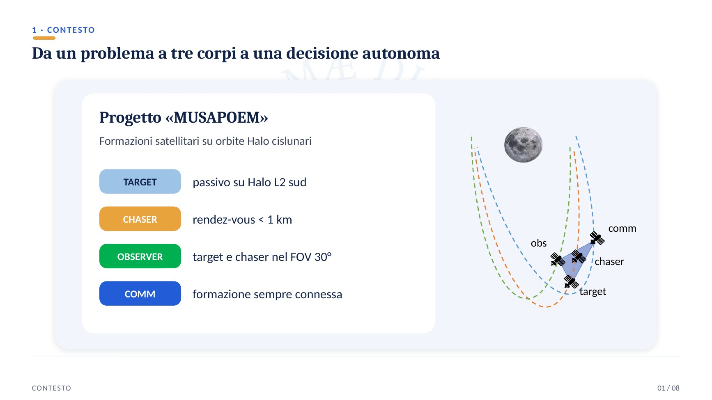
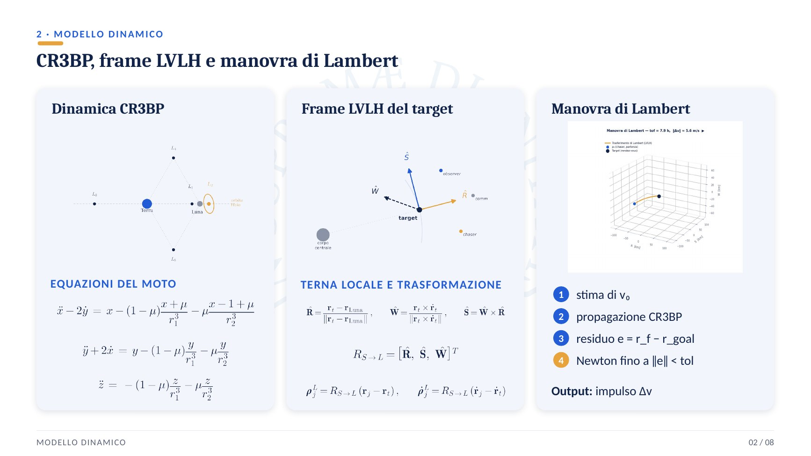
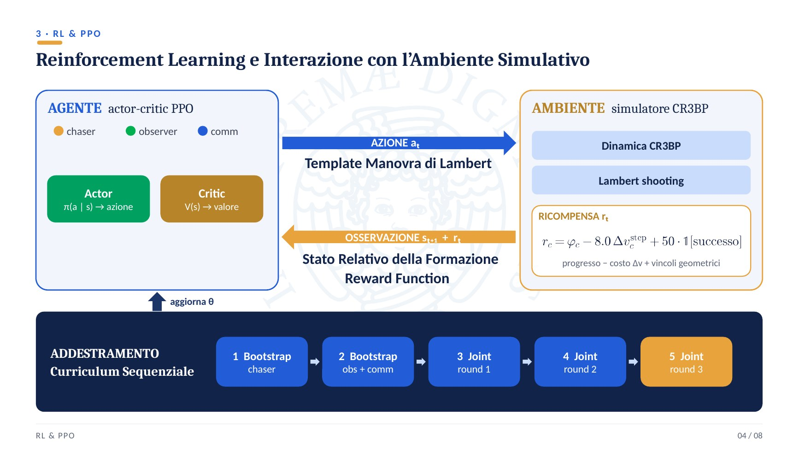
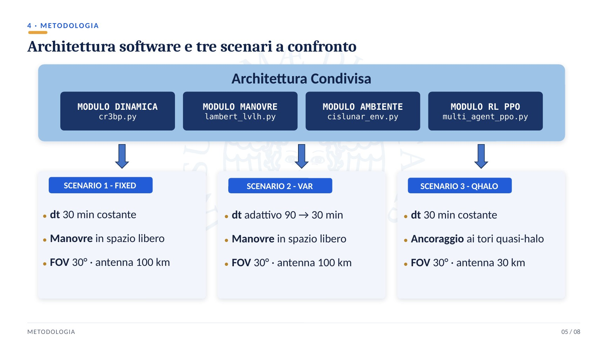
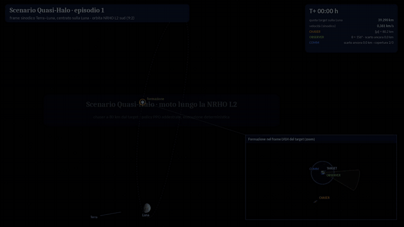
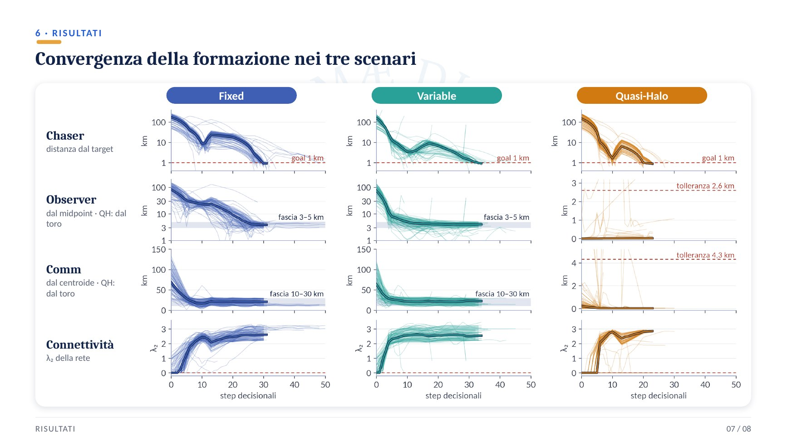
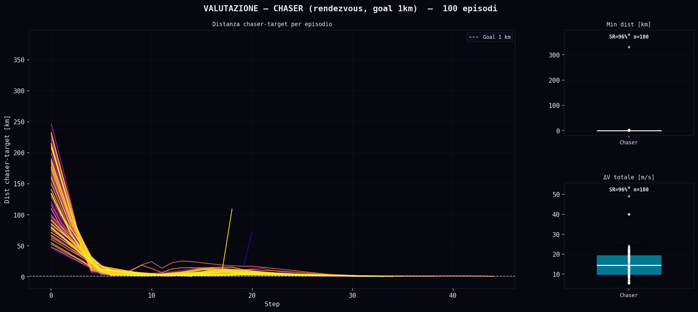
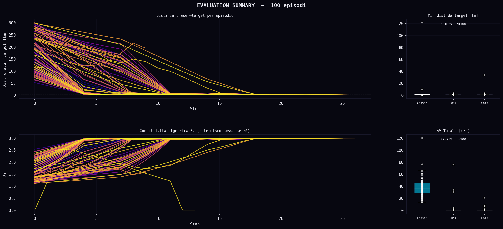

# Multi-Agent Reinforcement Learning for Satellite Formation Guidance in Cislunar Space

**M.Sc. thesis – Robotics and Automation Engineering, University of Pisa (2026)**
Supervisor: Prof. Giordana Bucchioni · Grade: 110/110 cum laude

*Trained policies running in the CR3BP simulator (adaptive-step scenario, deterministic execution). Left: the formation in the target's LVLH frame and the Lambert maneuvers chosen by the agents. Right: live chaser–target distance (goal < 1 km), observer pointing angle (camera FOV 30°) and comm distance from the formation centroid (10–30 km band).*

## In short

- **Problem:** a small spacecraft formation operating near the Lunar Gateway orbit (Earth–Moon L2 southern NRHO) has to perform a **rendezvous**, keep the **target in view** and stay **connected**, all under strongly nonlinear three-body dynamics.
- **Approach:** three cooperating agents trained with **PPO** (on-policy RL) in a custom **Gymnasium** simulator of the CR3BP. Each agent picks **Lambert maneuvers** instead of solving an optimization problem online.
- **Results:** **93.6–99.2% rendezvous success** over 10,000 test episodes, up to **34% less Δv** with an adaptive time step, and a decision in **milliseconds** instead of tens to hundreds of seconds per planning cycle for the optimization-based reference approach.
- **My contribution:** the whole work: simulator, environments, reward design, training curriculum, evaluation and analysis.

## 1. Mission scenario

| Agent | Task |
|---|---|
| **Target** | Passive, follows the southern L2 Halo orbit |
| **Chaser** | Rendezvous with the target (< 1 km) |
| **Observer** | Keeps target and chaser inside a 30° camera field of view |
| **Comm** | Keeps the whole formation connected |

## 2. Dynamics and maneuvers

- **Circular Restricted Three-Body Problem (CR3BP)** in the Earth–Moon synodic frame; relative motion expressed in the target's **LVLH** frame.
- Every maneuver is a single impulse computed by a **Lambert solver**, using shooting with Newton correction in the full CR3BP dynamics.

## 3. Reinforcement learning setup

- **Actor–critic PPO** (Stable-Baselines3 + PyTorch), one policy per agent, discrete action space of Lambert-maneuver templates.
- Reward: progress toward the goal, minus Δv cost and geometric-constraint penalties, plus a success bonus (potential-based shaping).
- **Sequential curriculum** in five phases with convergence gates: each agent first trains alone (bootstrap), then all three train jointly over three rounds.

## 4. Three scenarios compared

1. **Fixed** – constant 30-min time step, maneuvers in free space.
2. **Variable** – adaptive time step (90 → 30 min) driven by a finite-state machine with hysteresis on the chaser–target distance, plus overshoot prevention.
3. **Quasi-Halo** – observer and comm are **anchored to invariant quasi-halo tori** of the CR3BP, computed with the GMOS method. This is a structural constraint on the action space.

*Quasi-Halo scenario: the formation along the NRHO in the Earth–Moon synodic frame, with a zoom on the LVLH configuration.*

## 5. Results

*Each column is a scenario, each row an agent's objective over the decision steps (thin lines = single episodes, thick line = median). All agents converge to their target band, and network connectivity (λ₂) stays positive.*

Statistical evaluation on **10,000 independent episodes** with deterministic policies:

| | Fixed step | Adaptive step | Quasi-Halo |
|---|---|---|---|
| Rendezvous success rate | 96.8% | 93.6% | **99.2%** |
| Δv vs. fixed step | – | **−34% chaser, −14% observer, −21% comm** | much lower formation-keeping cost for observer and comm |

- The adaptive step saves fuel for every agent. Its slightly lower success rate comes from a small, well-identified group of episodes rather than a general loss of performance.
- Anchoring to quasi-halo tori gives the most reliable rendezvous and the cheapest formation keeping.

## Documents

- 📄 [Extended thesis summary (10 pages, Italian)](docs/thesis_summary_it.pdf)

<b>Additional figures</b>

| | |
|---|---|
|  |  |
| Training curves, fixed-step scenario | Adaptive time step during an episode |
|  |  |
| Observer field of view on the scene | Lambert impulses commanded by each agent |
|  |  |
| Quasi-halo formation in 3D | Deviation from the tori over 10,000 episodes |
|  |  |
| Chaser evaluation, adaptive step | Evaluation summary, Quasi-Halo |

## Limitations and future work

The CR3BP model is idealized, there is no centralized critic, and the Quasi-Halo variant uses a fixed time step. Next steps: centralized multi-agent architectures (MAPPO, MADDPG), an adaptive step for the Quasi-Halo variant, and higher-fidelity ephemeris models.

## Project context

This work was carried out within the *MUSAPOEM* research project, funded by the Italian Space Agency (ASI). This page presents the method and the results; the implementation belongs to the project.

## Tech stack

`Python` · `PyTorch` · `Stable-Baselines3` · `Gymnasium` · `NumPy` · `SciPy` · `Matplotlib`

## Author

**Andrea Sodini** – Robotics & Automation Engineer · [LinkedIn](https://www.linkedin.com/in/andrea-sodini-4b36a2273)
