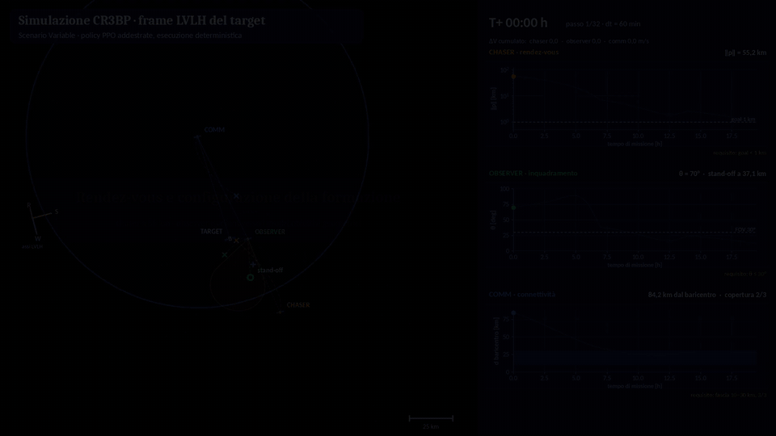
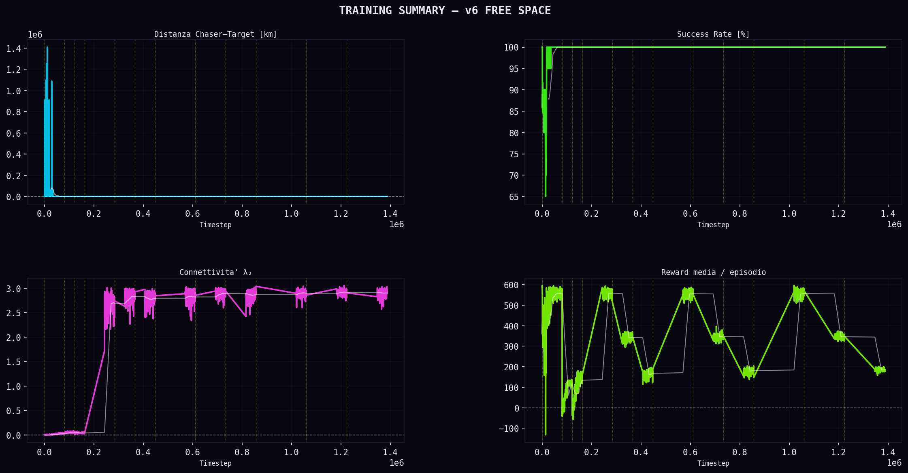
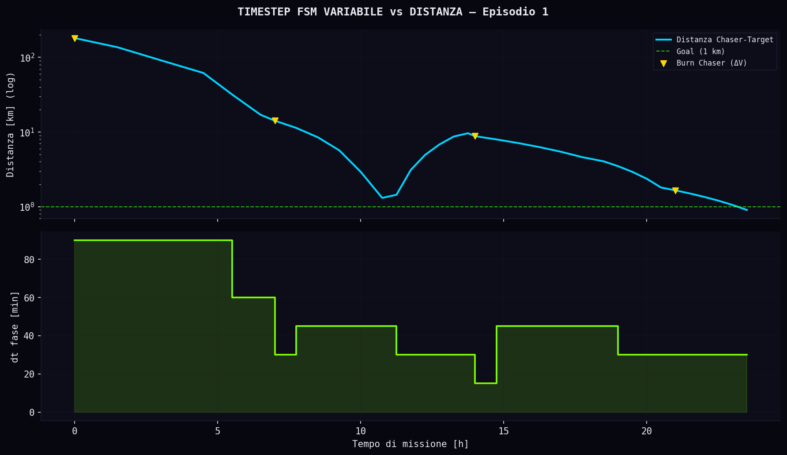
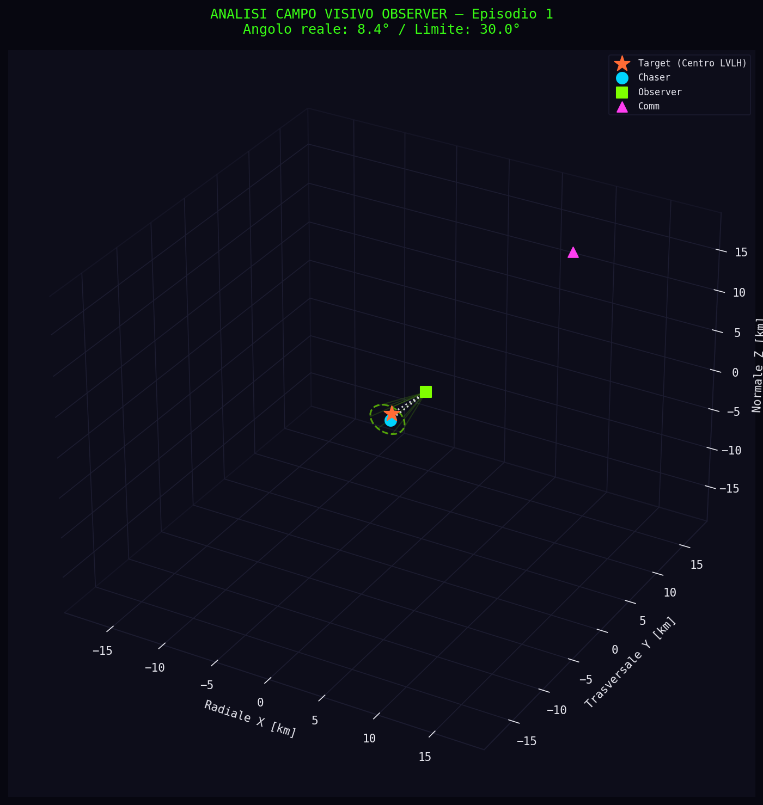
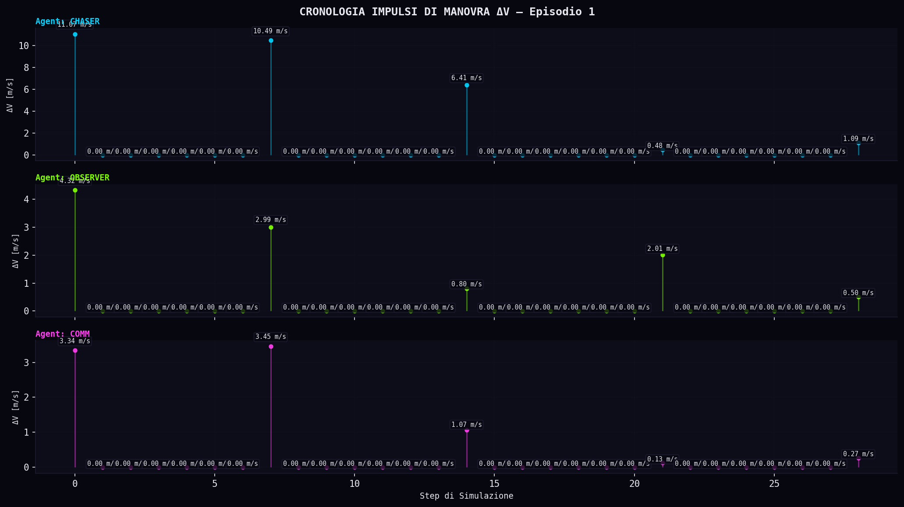
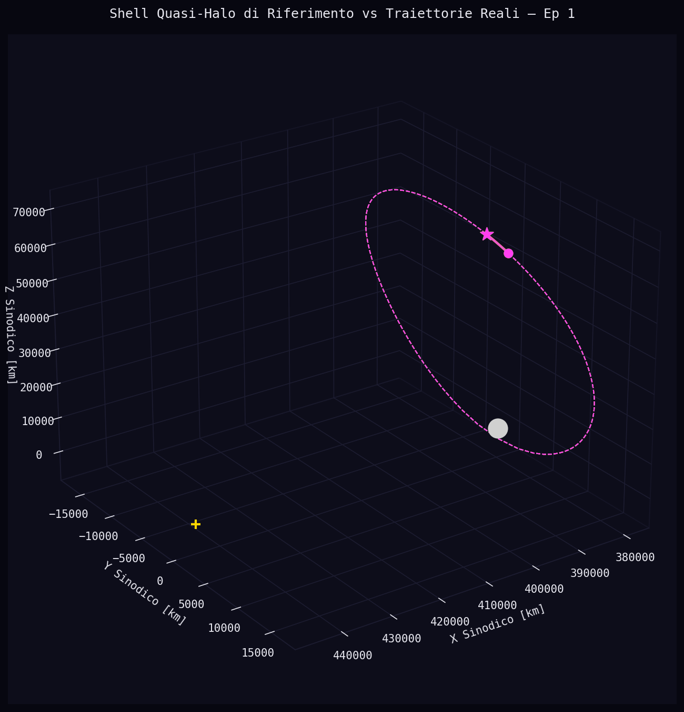
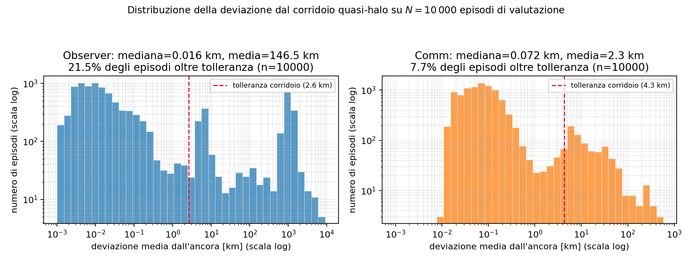

# Multi-Agent Reinforcement Learning for Satellite Formation Guidance in Cislunar Space

**M.Sc. thesis – Robotics and Automation Engineering, University of Pisa (2026)**
Supervisor: Prof. Giordana Bucchioni · Grade: 110/110 cum laude

## Overview

This project studies how a small formation of satellites can cooperate autonomously around a **Near-Rectilinear Halo Orbit (NRHO)** about the Earth–Moon L2 point, the orbit family chosen for the Lunar Gateway.
Instead of solving an optimization problem at every planning cycle, each satellite is driven by a policy trained with **on-policy Reinforcement Learning (PPO)**. Once trained, a decision takes a single forward pass of the network (milliseconds), versus tens to hundreds of seconds per planning cycle for the optimization-based reference approach.

The formation has four spacecraft:

| Agent | Task |
|---|---|
| Target | Passive, follows its reference orbit |
| Chaser | Performs the rendezvous with the target |
| Observer | Keeps the target inside its field of view |
| Comm | Keeps the whole formation connected |

## Technical approach

- **Dynamics:** Circular Restricted Three-Body Problem (CR3BP) in the synodic frame; relative motion in the LVLH frame.
- **Maneuvers:** single-impulse maneuvers generated by a **Lambert solver** (differential shooting in the full CR3BP dynamics).
- **Learning:** PPO, multi-agent setting with **sequential curriculum learning** (agents trained first in isolation, then jointly; five phases with convergence gates); potential-based reward shaping; discrete action space.
- **Simulation:** custom **Gymnasium** environment; training with **Stable-Baselines3** and **PyTorch**.

Three environment variants were developed and compared:

1. **Fixed time step** (dt = 30 min).
2. **Adaptive time step**: a four-phase finite-state machine with hysteresis shortens the step as the chaser approaches the target, plus an overshoot-prevention mechanism for Lambert maneuvers.
3. **Quasi-halo anchoring**: observer and comm are anchored to an invariant quasi-halo torus of the CR3BP, computed with the GMOS method (invariant-curve discretization + Newton multiple shooting); this adds a structural constraint on the action space (phase hops and shell changes).

## Results

Evaluation on **10,000 independent episodes** with deterministic policy:

| Variant | Rendezvous success rate |
|---|---|
| Fixed time step | 96.8% |
| Adaptive time step ("hardened") | 93.6% |
| Quasi-halo anchoring | 99.2% |

- The adaptive time step **reduced Δv consumption** for all active agents: about **−34% chaser, −14% observer, −21% comm**, with a slightly lower success rate traced back to a small, well-identified subset of episodes.
- Quasi-halo anchoring gave a markedly **lower formation-keeping cost** for observer and comm than the free-space variants.

| | |
|---|---|
|  |  |
| Training summary (fixed step) | Adaptive time-step logic during an episode |
|  |  |
| Observer field of view on the scene | Lambert maneuver impulses |
|  |  |
| Quasi-halo formation in 3D | Deviation distribution over 10,000 episodes |

## Limitations and future work

Idealized CR3BP model, no centralized critic, fixed time step in the quasi-halo variant. Next steps: comparison with centralized multi-agent architectures (MAPPO, MADDPG), adaptive step for the quasi-halo variant, higher-fidelity ephemeris models.

## Code availability

The work was carried out within the research activity on the *MUSAPOEM* project, funded by the Italian Space Agency (ASI). The source code is not published in this repository; this page documents the method and the results.

## Tech stack

`Python` · `PyTorch` · `Stable-Baselines3` · `Gymnasium` · `NumPy` · `SciPy` · `Matplotlib`

## Author

**Andrea Sodini** – Robotics & Automation Engineer · [LinkedIn](https://www.linkedin.com/in/andrea-sodini-4b36a2273)
